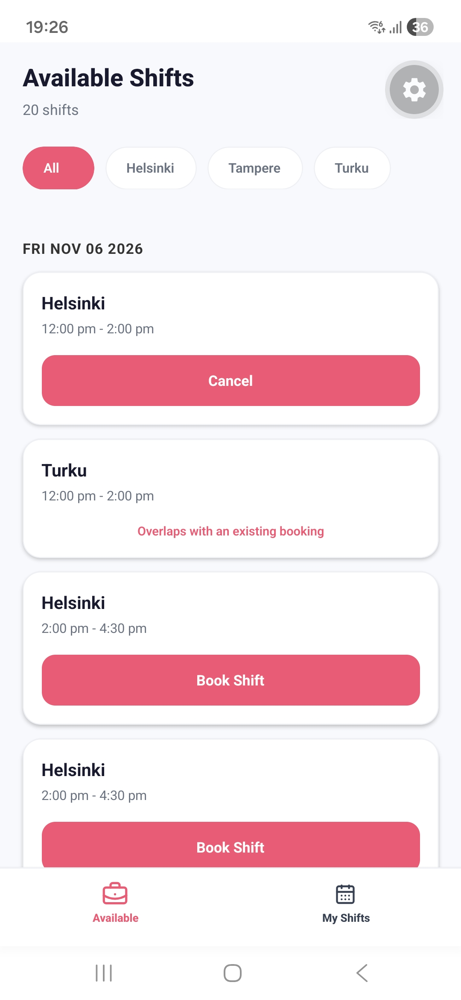
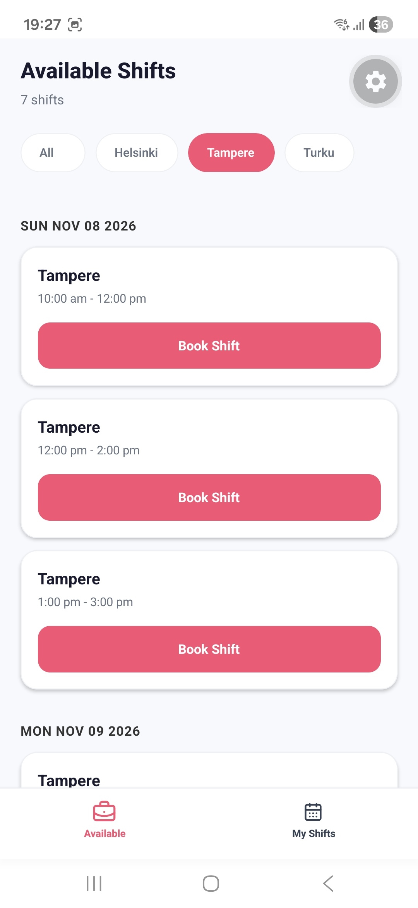
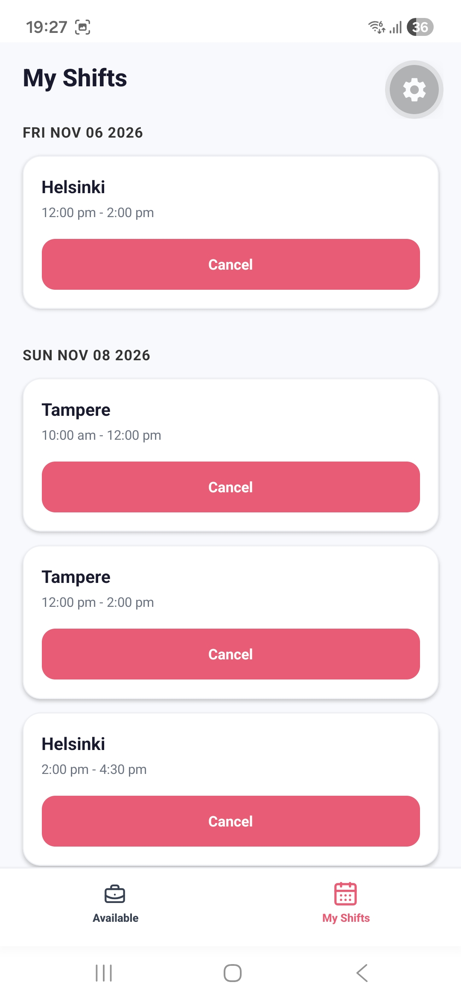
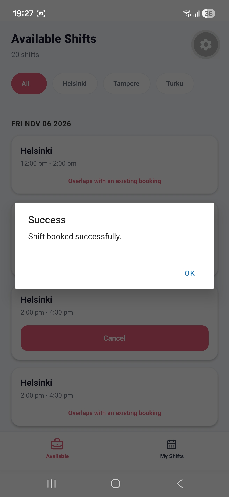
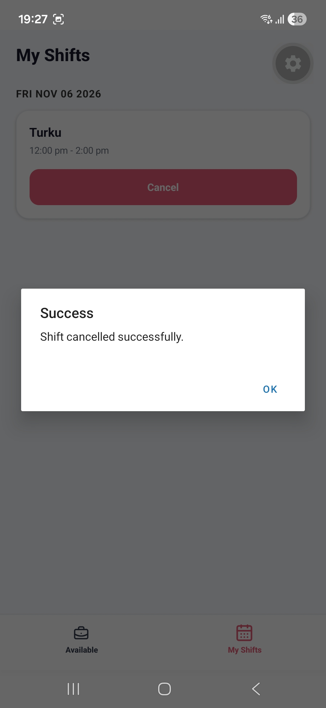

# Shift Booking App

A mobile shift booking application built with React Native, Expo,
TypeScript, and Hapi.js.

Users can browse available shifts, filter them by city, book shifts,
cancel bookings, and manage their scheduled shifts.

## Screenshots

<table>
  <tr>
    <td width="50%">
      <h3>Available Shifts</h3>
      
    </td>
    <td width="50%">
      <h3>Filter by City</h3>
      
    </td>
  </tr>
  <tr>
    <td width="50%">
      <h3>My Shifts</h3>
      
    </td>
    <td width="50%">
      <h3>Booking Success</h3>
      
    </td>
  </tr>
  <tr>
    <td width="50%">
      <h3>Cancellation Success</h3>
      
    </td>
    <td></td>
  </tr>
</table>

## Installation & Setup

## Installation

### 1. Clone the Repository

```bash
git clone https://github.com/ahmadfaizan18/shift-booking-app.git
cd shift-booking-app
```

### 2. Install Dependencies

From the project root directory, run:

```bash
npm install
npm --prefix backend install
npm --prefix frontend install
```

### 3. Configure Environment Variables

Create a `.env` file inside the `frontend` directory by copying the
example file:

``` bash
cp frontend/.env.example frontend/.env
```

Open `frontend/.env` and configure the API URL:

``` env
EXPO_PUBLIC_API_URL=http://YOUR_LAPTOP_IP:8080
```

**Finding Your Laptop's IP Address**

1.  Connect your laptop and phone to the same Wi-Fi network.

2.  Open Command Prompt or Git Bash on your laptop.

3.  Run the following command:

    ``` bash
    ipconfig
    ```

4.  Find the **Wireless LAN adapter Wi-Fi** section.

5.  Copy the **IPv4 Address** (for example, `192.168.1.5`).

6.  Replace `YOUR_LAPTOP_IP` in `frontend/.env` with your actual IPv4
    address.

For example:

``` env
EXPO_PUBLIC_API_URL=http://192.168.1.5:8080
```

Use your actual laptop IP address, not the example above.

### Environment API URL

Configure `EXPO_PUBLIC_API_URL` in `frontend/.env` according to your environment:

| Environment | API URL |
|---|---|
| Physical Android/iOS device | `http://YOUR_LAPTOP_IP:8080` |
| Android emulator | `http://10.0.2.2:8080` |
| iOS simulator | `http://localhost:8080` |

**Note:**
- The `.env` file is local and should not be committed to Git.
- For physical devices, the phone and laptop must be connected to the same Wi-Fi network.
- Replace `YOUR_LAPTOP_IP` with your laptop's local IPv4 address.

### 3. Start the Application

The backend and frontend must be started in separate terminals.

**Terminal 1 – Start the Backend**

From the project root directory, run:

```bash
npm run backend
```

The backend server starts on port `8080`.

**Terminal 2 – Start the Frontend**

Open another terminal in the project root directory and run:

```bash
npm run frontend
```

Expo will start the frontend development server and display a QR code. Scan the QR code using Expo Go on your mobile device.

**Stopping the Application**

Press `Ctrl + C` in each terminal to stop the respective server.

### 4. View the App Using Expo Go

1.  Install **Expo Go** on your Android or iOS device.
2.  Make sure your phone and laptop are connected to the same Wi-Fi
    network.
3.  Start the application using `npm run dev`.
4.  Wait for the Expo QR code to appear in the terminal.
5.  Open Expo Go on your phone and scan the QR code.
6.  The application will open on your phone and connect to the backend
    running on your laptop.

**Note:** If you make changes to the `.env` file, restart the Expo
development server for them to take effect.

## Tech Stack

<table>
  <tr>
    <th align="left">Frontend</th>
    <th align="left">Backend</th>
  </tr>
  <tr>
    <td valign="top">
      <ul>
        <li>React Native</li>
        <li>Expo</li>
        <li>TypeScript</li>
        <li>Zustand</li>
        <li>TanStack Query</li>
        <li>Axios</li>
      </ul>
    </td>
    <td valign="top">
      <ul>
        <li>Node.js</li>
        <li>Hapi.js</li>
        <li>Babel</li>
        <li>Mock API</li>
      </ul>
    </td>
  </tr>
</table>       

## Features

-   Browse available shifts grouped by date.
-   Filter shifts by city: Helsinki, Tampere, and Turku.
-   Book and cancel shifts.
-   View all booked shifts in My Shifts.
-   Prevent overlapping shift bookings.
-   Loading and error states for API operations.
-   Chronological shift sorting.
-   Centralized state management and API caching.

## Project Structure

``` text
ShiftBookingWorkspace/
├── backend/
│   ├── api/
│   │   ├── server.js
│   │   └── shifts-mock-api/
│   └── package.json
│
├── frontend/
│   ├── app/
│   ├── src/
│   │   ├── hooks/
│   │   ├── services/
│   │   ├── store/
│   │   ├── types/
│   │   └── utils/
│   ├── .env.example
│   ├── package.json
│   └── app.json
│
├── .gitignore
├── package.json
├── package-lock.json
└── README.md
```

## Prerequisites

-   Node.js 18 or higher
-   npm
-   Expo Go on an Android/iOS device, or an emulator/simulator

## API Endpoints

All endpoints are prefixed with `/shifts`.

| Method | Endpoint | Description |
|:---:|---|---|
| `GET` | `/shifts` | Retrieve all shifts |
| `GET` | `/shifts/{id}` | Retrieve a shift by ID |
| `POST` | `/shifts/{id}/book` | Book a shift |
| `POST` | `/shifts/{id}/cancel` | Cancel a booked shift |

## Shift Data Model

| Field | Type | Description |
|---|---|---|
| `id` | String | Unique shift identifier |
| `area` | String | Helsinki, Tampere, or Turku |
| `booked` | Boolean | Booking status |
| `startTime` | Number | Start time in Unix milliseconds |
| `endTime` | Number | End time in Unix milliseconds |

## Troubleshooting

| Problem | Solution |
|---|---|
| Backend fails to start | Ensure backend dependencies are installed. |
| Frontend cannot connect to backend | Check `EXPO_PUBLIC_API_URL` and Wi-Fi connectivity. |
| Port 8080 already in use | Stop the existing process using port 8080. |
| Android emulator cannot reach backend | Use `http://10.0.2.2:8080`. |
| Environment changes are not reflected | Restart Expo with `npx expo start -c`. |
| TypeScript errors | Run `npx tsc --noEmit` inside `frontend/`. |
  -----------------------------------------------------------------------
